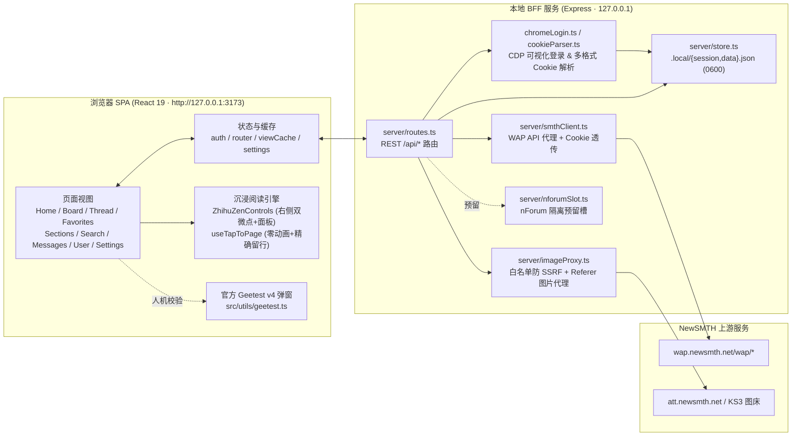

# newsmth-reader 系统现状总览（System Status）

> **更新日期**：2026-11-22  
> **版本**：`v1.0.0`（含最新 Zhihu-Zen 1:1 沉浸式阅读与零动画精准翻页升级）  
> **开源仓库**：`https://github.com/dvbs2000/newsmth-reader`（MIT License，本地运行）

---

## 1. 项目定位与当前运行状态

**`newsmth-reader`** 是一个面向桌面端与响应式浏览器的**水木社区（NewSMTH）本地极简阅读客户端**，灵感源自 `Maxwin-z/xsmth-newsmth`，并完整融合了 **Zhihu Zen 沉浸式电子书阅读体验**。系统主打「无广告、无侧栏干扰、宽屏高密度排版、全套零动画精准翻页、完整账号读写与本地隐私隔离」。

- **运行形态**：本地单机 `Node.js BFF + React SPA`，仅监听本机回环地址 `http://127.0.0.1:3173`（开发态 BFF 为 `3174`、Vite 前端为 `3173`；生产态由 Express 单进程统一托管静态产物与 `/api/*`）。
- **核心质量门禁**：TypeScript 前后端严格类型检查（`npm run typecheck`）、生产构建（`npm run build`）及单元/集成测试（`npm test`，`6/6` 全通过）均处于绿色通过状态；并已通过 Headless Chrome 实测验证（控制台 `0` 报错）。
- **合规与安全基线**：
  - 仓库零商业字体文件、零个人隐私信息、零上游站点凭据；
  - 所有账号 Cookie、偏好配置、自定义字体均严格落盘在 `.gitignore` 忽略的 `.local/` 目录（`0600` 文件权限）；
  - 严格遵守「零反爬/零验证码绕过」原则：登录与写操作人机验证均通过可视化官方 UI 由用户本人手动完成。

---

## 2. 技术栈与系统架构

### 2.1 技术选型
| 层级 | 技术栈 | 说明 |
|---|---|---|
| **运行时** | Node.js `>= 22` + `npm` | 锁定 `package-lock.json`，零额外运行依赖 |
| **前端** | React 19 + TypeScript + Vite 6 + 原生 CSS Custom Properties + `lucide-react` | 零重型 UI 框架，原生 `<dialog>` 弹窗，轻量高速 |
| **后端（本地 BFF）** | Express 4 + TypeScript + `multer` v2 + `tsx` | 代理上游 API、管理本地 Cookie、SSRF 防护图片代理与本地存储 |
| **上游协议** | 主力 `https://wap.newsmth.net/wap/*` UTF-8 JSON API | 预留 `server/nforumSlot.ts` 独立隔离槽，便于后续扩展 `nForum` 回退能力 |

### 2.2 模块架构与数据流



---

## 3. 代码目录与核心模块说明

### 3.1 后端（`server/`，9 个文件）
| 文件 | 职责 |
|---|---|
| `server/index.ts` | Express 入口，开发/生产双模式启动与静态资源托管 |
| `server/config.ts` | 端口、路径常量与跨平台本机 Chrome/Edge 可执行文件探测 |
| `server/routes.ts` | 完整 `/api/*` 路由（认证、本地数据、自定义字体、热点、版面、帖子读写、收藏、消息、搜索、图片代理） |
| `server/smthClient.ts` | 封装 `wap.newsmth.net` 请求协议（`x-www-form-urlencoded` 表单编码、时间戳、Cookie 维护与写操作人机验证透传） |
| `server/chromeLogin.ts` | 方案 B：通过本地 CDP 启动独立可见 Chrome/Edge 窗口，用户手动完成登录与验证码后捕获 `HttpOnly` Cookie 并经 `/wap/api/profile` 校验落盘 |
| `server/cookieParser.ts` | 方案 A：多格式 Cookie 解析器，支持 Netscape `cookies.txt`（含 `#HttpOnly_`）、`Cookie:` 头、`Copy as cURL` 与 JSON |
| `server/imageProxy.ts` | `/api/proxy/image` 隐身图片代理，严格白名单主机名校验（防止 SSRF）并注入正确 `Referer` |
| `server/store.ts` | `.local/session.json`、`.local/data.json` 原子写入与 `prefVersion: 2` 偏好自动迁移 |
| `server/nforumSlot.ts` | 独立的 `www.newsmth.net/nForum` 会话与扩展适配预留槽 |

### 3.2 前端（`src/`，33 个文件）
- **页面（`src/pages/`）**：
  - `HomePage.tsx`：首页热点（今日十大 / 全站热帖 / 分区热点 / 人气版面）与快捷搜索入口；
  - `BoardPage.tsx`：版面主题列表（主题 / 置顶 / 精华、排序切换、版内搜索、发新帖、收藏版面、30s 静默新帖探测）；
  - `ThreadPage.tsx`：帖子详情页（并行拉取 `topic/detail` 主楼 + `loadArticlesByMode` 回帖、亮评 Likes、正序/只看楼主/最新/精华/只看TA、回复/编辑/删除/Like、帖尾增量查新回复）；
  - `FavoritesPage.tsx`：云端收藏版面（兼容解析嵌套 `favBoards[].items[].bid` 与文件夹）、本地收藏版面及云端收藏帖；
  - `SectionsPage.tsx`：全站分区与层级版面浏览；
  - `SearchPage.tsx`：全站帖子与版面搜索；
  - `MessagesPage.tsx`：站内信会话与系统通知中心；
  - `UserPage.tsx`：用户资料与动态页；
  - `SettingsPage.tsx`：字体管理、主题色板、宽度/字号、摸鱼图控、内容净化与本地屏蔽词/屏蔽用户管理。
- **核心组件（`src/components/`）**：
  - `TopBar.tsx`：非固定圆角卡片顶栏（随滚动自然滚走，滚出后左上角出现 `6px` 极隐蔽微点可随时唤出）；
  - `ZhihuZenControls.tsx`：**右上角 `6px` 微点**（点击弹出 `340px` 知乎风沉浸控制面板，无需跳设置页即可调宽/字号/夜间/图控）+ **右下角 `6px` 微点**（帖子页一键瞬时跳下一楼）；
  - `FloorCard.tsx`：独立白底楼层卡片（主楼配知乎蓝 `▲ 赞同` 胶囊，回帖桌面端悬停行内操作零垂直占位，引用块折叠轻量化）；
  - `TopicRow.tsx`：同时支持紧凑纯标题列表（默认）与摘要卡片流两种呈现；
  - `ComposerDialog.tsx`、`LoginDialog.tsx`、`CommandPalette.tsx`、`ShortcutsDialog.tsx`、`Lightbox.tsx`、`ModalDialog.tsx`、`LeftDrawer.tsx`、`StealthImage.tsx`、`LoadMoreSentinel.tsx`、`Toast.tsx`。
- **状态、引擎与工具（`src/state/`、`src/hooks/`、`src/utils/`）**：
  - `useTapToPage.ts`：全站零动画瞬间翻页 + 视口边缘真实行框精准留行引擎；
  - `router.tsx` + `viewCache.ts`：应用内历史栈与内存视图快照缓存（支持 `←` / `→` 瞬间前进后退并像素级恢复滚动位置）；
  - `settings.tsx` + `auth.tsx`：主题/字体/宽度实时 CSS 变量同步（配合 `index.html` 首屏预水合脚本消除闪烁）；
  - `content.ts`：纯结构化正文解析器（严禁 `dangerouslySetInnerHTML`，支持 HTML 清洗、引用折叠、客户端尾巴自动剥离、外链与内联图片提取）；
  - `geetest.ts`：写操作触发上游 `code === 3` 时挂载官方 Geetest v4 人机验证（并自动避让原生 `<dialog>` Top Layer）；
  - `fonts.ts` + `favorites.ts` + `format.ts`：字栈解析与 `@font-face` 动态注入、云端收藏解析与时间格式化。

---

## 4. 核心功能与阅读体验现状

### 4.1 账号认证与完整读写
- **双通道登录**：
  - **方案 B（推荐）**：一键拉起本机独立 Chrome/Edge 窗口，人工完成水木登录与验证后自动同步登录态；
  - **方案 A（免开浏览器）**：支持粘贴 `cookies.txt`、`Cookie:` 请求头、`Copy as cURL` 或 JSON 一键导入。
- **完整交互能力**：支持发新帖、引用回复、编辑/删除本人楼层、上传图片附件、给主帖 Like 打分与短评、云端收藏/取消收藏帖子与版面、站内信收发。遇到上游要求人机验证时自动弹出官方 Geetest v4 验证框，由用户手动完成后自动续发。

### 4.2 知乎 Zen 1:1 视觉与紧凑阅读体系
- **默认字体与排印**：
  - 默认统一采用与知乎 Zen 一致的无衬线系统字栈：`-apple-system, BlinkMacSystemFont, 'PingFang SC', 'Helvetica Neue', 'Microsoft YaHei', sans-serif`（配合抗锯齿渲染），同时保留设置页切换系统字体或导入本地 `.ttf/.otf/.woff2` 字体（存放于 `.local/fonts/`）。
  - 默认正文 **`16px`**（支持 `14–22px` 无级拖动）、行高 **`1.66`**、段距 **`0.45em`**，帖子主标题 `21px` 加粗（`700`）。
- **四套阅读主题**：
  - **日间柔灰（默认）**：`#f4f6f9` 画布 + `#ffffff` 纯白卡片 + `#ebebeb` 细边 + `#0066ff` 知乎蓝；
  - **深蓝夜间（`navy`）**：`#0b1120` 画布 + `#151f32` 卡片 + `#26334d` 边框 + `#3b82f6` 主蓝；
  - 另提供 **深灰夜间（`dark`）**、**OLED 纯黑（`oled`）** 与 **跟随系统（`system`）**。
- **宽屏百分比布局与页面分工**：
  - 默认 **`98%`** 满屏宽（支持 `50%–100%` 滑块与 `100/98/90/80/68%` 快捷档，动态调节 `--card-pad-x: 10 / 14 / 20px`）。
  - **首页热点 & 版面列表（如水木特快）**：均默认采用**纯标题紧凑列表**（高频扫读无干扰，顶栏图标或设置页可独立切换摘要卡片流）。
  - **帖子详情页**：顶部独立 `.thread-header-card`（去重控制条）+ 下方独立 `.floor-card` 白卡；针对水木短回帖场景专项收紧留白（1 句话回帖仅 `80px` 高，带折叠引用 `114px` 高，`1280×900` 单屏可容纳约 **`7.5` 楼**）：
    - 折叠态引用收为轻巧单行文字 `› 引用 xxx（N行）`，点击展开才显示灰底左竖线引用框；
    - 桌面端回帖操作（回复/只看TA/编辑/删除/屏蔽）收入作者同行右侧悬停显现，零额外垂直占位；仅主楼底部保留知乎蓝 `▲ 赞同 N` 胶囊。

### 4.3 全套零动画瞬间翻页与「100% 稳留一行」引擎
- **零动画切屏**：点击半屏翻页、`Space` / `Shift+Space` / `PageDown` / `PageUp`、`J` / `K` 切楼、右下角微点跳楼全部执行 `behavior: 'instant'`，同时关闭正文阅读区卡片多余 CSS `transition`；鼠标滚轮与触控板保留浏览器原生滚动。
- **视口边缘真实行框扫描（`< 0.3ms`）**：
  - **帖子详情页**：利用 `Range.getClientRects()` 直接扫描视口边缘可见卡片内的真实文字行框（跳过孤立灰色折叠引用条与隐藏按钮），哪怕 1 个字的短回帖也不会打空；下翻永远把最后一行完整正文拉到新屏 `top: 10px`（若底行是新卡片首行则对齐卡片顶边），上翻把顶行精准落回新屏底端 `vh - 10px`；
  - **首页与版面列表页**：按 `.topic-row` 整行对齐，下翻永远将底行帖子完整保留到新屏第一行，绝不劈半标题；
  - **防误翻保护**：支持 `hadSelectionOnMouseDown`（划词复制后点空白取消选区不翻页）、双击/路由切换 `380ms` 保护窗与交互元素过滤。

### 4.4 摸鱼防社死与浏览体验增强
- **三档控图（快捷键 `I`）**：纯文占位（零流量不露图） / 低饱和灰阶缩图 / 自动原图，点击图片均在原生 `<dialog>` Lightbox 中放大查看。
- **无感刷新与自动翻页**：页面触底自动加载下一页；列表页每 `30s` 静默探测新帖并弹出零位移悬浮提示条；帖子末尾支持一键增量检查新回复。
- **本地净化**：支持自动剥离客户端小尾巴与签名档、隐藏头像、本地屏蔽指定 ID 与关键词。

---

## 5. 常用快捷键速查

| 快捷键 | 作用域 | 功能 |
|---|---|---|
| `Space` / `PageDown` | 全站（非设置页） | 零动画瞬间向下翻屏（精准保留 1 行 / 1 整条标题） |
| `Shift+Space` / `PageUp` | 全站（非设置页） | 零动画瞬间向上翻屏（精准保留 1 行） |
| 点击下半屏 / 上半屏 | 帖子内（及列表空白区） | 电子书点按瞬间翻屏 |
| `←` / `→`（或 `Esc`） | 全局 | 应用内后退 / 前进（毫秒级恢复原滚动位置） |
| `/` | 全局 | 打开版面直达与全站快捷搜索面板 |
| `D` / `I` | 全局 | 切换主题色板 / 切换三档图片防社死模式 |
| `J` / `K` | 帖子内 / 列表页 | 瞬间跳转下一楼/上一楼（列表页切换焦点行，`Enter` 打开） |
| `O` / `R` / `U` | 帖子内 | 切换只看楼主 / 回复主帖 / 强制刷新当前页 |
| `?` | 全局 | 打开快捷键帮助弹窗 |

---

## 6. 命令、测试与版本同步现状

### 6.1 常用命令
```bash
npm install        # 安装依赖
npm run dev        # 启动开发态（BFF :3174 + Vite :3173）
npm run typecheck  # 严格 TypeScript 前后端类型检查
npm test           # 运行核心单测与 BFF 集成测试（node --test）
npm run build      # 类型检查 + 打包 dist/ 与 dist-server/
npm start          # 单进程启动本地生产服务（http://127.0.0.1:3173）
```

### 6.2 验收基线
- **单元测试（`npm test`）**：`6/6` 通过，覆盖多格式 Cookie 解析、图片代理 SSRF 防护白名单、正文 HTML 清洗/引用折叠/去尾、BFF 健康检查与实时十大接口、云端嵌套收藏板解析、自定义字体栈解析。
- **真机 Chrome 验证**：已完整实测首页热点、水木特快版面、帖子详情（浅色/深蓝夜间/340px 悬浮面板）、连续 `Space`/`Shift+Space`/`J` 零动画翻页与精准留行、划词取消防误翻，控制台 `0` 报错。

### 6.3 版本演进里程碑
- **初始开源基线（`da3c607`）**：完整本地 BFF + SPA 读写客户端、双通道登录、官方 Geetest v4 验证、隐身图控与跨平台启动。
- **本轮重大阅读体验升级**：
  - Zhihu Zen 1:1 视觉与默认系统字栈重构（98% 满屏流、`16px` 知乎字栈、浅色/深蓝配色、圆角卡片顶栏、`ZhihuZenControls.tsx` 右侧双微点与 340px 沉浸控制面板）；
  - 首页热点与版面列表样式解耦且统一默认纯标题紧凑列表（`listStyle` / `boardListStyle`）；
  - 帖子详情页高密度独立卡片校准（折叠引用轻量化、悬停行内操作零垂直占位、顶部去重）；
  - 全套零动画瞬间翻页（`Space`/`PageDown`/`PageUp`/`J`/`K`/点半屏）+ `Range.getClientRects()` 视口边缘真实行框精准留行引擎；
  - `prefVersion: 2` 本地配置自动迁移。
- **配套文档**：架构红线见 [AGENTS.md](./AGENTS.md)，视觉规范见 [DESIGN.md](./DESIGN.md)，安装与使用见 [README.md](./README.md)。
